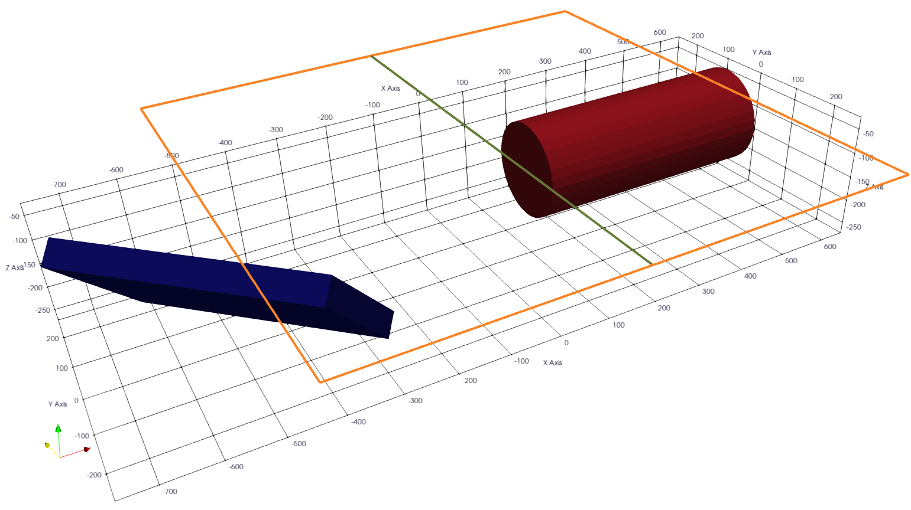

# Forward Model description

## General infromation before running inversion

- This forward model was designed to simulat a land-based, ground-based
transmitter (except AMT) and receiver setup to simulate either frequency-domain
or time-domain electromagentic field data, or impedances and tipper data
without a controlled-source

- The models can contain either 1 or 2 Rx patches and 1 or 2 Tx (grounded/loop)

- Simulation can be computed for any single Rx patch (AMT, resulting in one or
two result data files) or any single combination of Rx patch / Tx type
(CSEM, TEM, up to four results data files, see
[Data format](#data-format-to-provide-simulation-results))

- This model may serve as basis for further modifications, such as up- or down-
scaling to mimic shallower or deeper exploration scales, or include topography
airborne receivers, or other features...

*3D view of central model area, anomalies (plate: blue, cylinder: red) and
transmitters (dipole: green, loop: orange).*

*XY_horizontal slice at surface of model; Tx (dipole: green, loop: orange),
Rx (blue dots), and the two anomalies are indicated.

*XZ-vertical slice through the model with layers, anomalies (greyish colors),
and receivers at the surface (blue dots); resistivity values are indicated.*

- **2 layer model**:
    - 1st layer thickness: 
        300m
    - resistivities: 
        500Ohmm, 5000Ohmm

- **2 possible Tx**:
    - grounded Tx: 
        1km from y=-500 to y=500m, x=0, z=0, see *setup* directory
    - loop Tx: 
        1km * 1km: x/y from (-500, -500) - (500, 500) m, see *setup* directory

- **2 possible Rx**:
    - central Rx profile: 
        4km from x=-2000 to x=2000, y=0, z=0, see *setup* directory
    - receiver grid: 
        4km * 800m with 50m inline x 100m point spacing, see *setup* directory 
        x/y from (-2000., -400) to (2000, 400) m

- **Anomaly description**
    - eastern anomaly: thin plate, tilted
        - incl: 
            45°
        - decl: 
            45°
        - thickness: 
            50m
        - size: 
            300m (length) * 500m (width)
        - center position: 
            (500, 0, -150)
        - resistivity: 
            10 Ohmm

    - western anomaly: cylinder
        - size: 
            100m radius * 500m length
        - center: 
            (400, 100, -150)
        - resistivity: 
            5000 Ohmm
        - dip: 
            90° (horizontal orientation along x axis)
        - dip_azimuth: 
            0°

- **CSEM setup**
    - frequencies: 
        [1, 10, 100, 1000, 10000] (Hz)

- **AMT setup**
    - frequencies: 
        [1, 10, 100, 1000, 10000] (Hz)
    - no CSEM TX but MT-like sources (Two polarizations as boundary-condition)

- **TEM setup**
    - times range: 
        [0.0001 - 1] (s), 41 log-steps with 10 per decade between 0.1ms and 1s

## Data format to provide simulation results

- Please provide seperate files for each Rx patch or combination of Rx and Tx
- Individual tags may include software used, date, modeler name

- **AMT setup**
    - *INDIVIDUAL_TAG_Rx0.dat*
    - *INDIVIDUAL_TAG_Rx1.dat*

- **CSEM/TEM setup**
    - *INDIVIDUAL_TAG_Rx0_Tx0.dat*
    - *INDIVIDUAL_TAG_Rx0_Tx1.dat*
    - *INDIVIDUAL_TAG_Rx1_Tx0.dat*
    - *INDIVIDUAL_TAG_Rx1_Tx1.dat*

## Model setup in custemx

### Mesh generation
    - **mesh generation script numbers**: *custemx/01...py*
    - central model with layered-earth geometry: 10 * 10 * 10 km
    - outer (halfspace) dimensions: 100 * 100 * 100 km
    - output mesh: vtk files in *meshes/tmp*, can be
      visualized with Paraview by opening the mesh *NAME.1.vtk*
    - Rx and Tx can be visualized with Paraview after mesh generation by
      importing *NAME_rx.vtk* and *NAME_tx.vtk* files
    - input for FE modeling: converted xdm5/h5 with meshtags in *meshes*

### FE simulation
    - **simulation script numbers**: *custemx/11...py*

### Visualization
    - **plot script numbers**: *custemx/21...py*