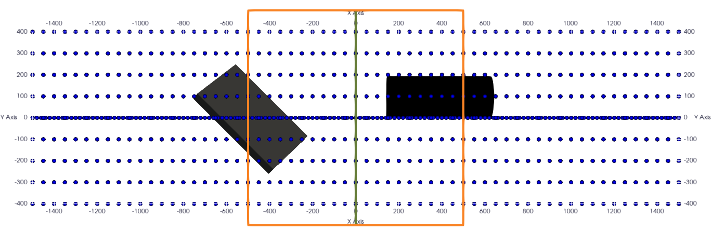
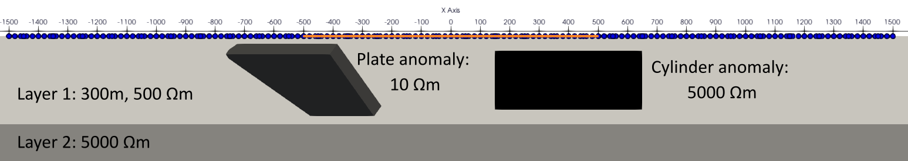

# Forward Model description

## General infromation before running inversion

- This forward model was designed to simulat a land-based, ground-based
transmitter (except AMT) and receiver setup to simulate either frequency-domain
or time-domain electromagentic field data, or impedances and tipper data
without a controlled-source

- The models can contain either 1 or 2 Rx patches and 1 or 2 Tx (grounded/loop)

- Simulation can be computed for any single Rx patch (AMT, resulting in one or
two result data files) or any single combination of Rx patch / Tx type
(CSEM, TEM, up to four results data files, see
[Data format](#data-format-to-provide-simulation-results))

- This model may serve as basis for further modifications, such as up- or down-
scaling to mimic shallower or deeper exploration scales, or include topography
airborne receivers, or other features...

*3D view of central model area, anomalies (plate: blue, cylinder: red) and
transmitters (dipole: green, loop: orange).*

*XY_horizontal slice at surface of model; Tx (dipole: green, loop: orange),
Rx (blue dots), and the two anomalies are indicated.

*XZ-vertical slice through the model with layers, anomalies (greyish colors),
and receivers at the surface (blue dots); resistivity values are indicated.*

## Model setup

- **2 layer model**:
    - 1st layer thickness: 
        300m
    - resistivities: 
        500Ohmm, 5000Ohmm

- **2 possible Tx**:
    - [Grounded Tx](./setup/tx_grounded.dat): 
        1km from y=-500 to y=500m, x=0, z=0,
    - [Loop Tx](./setup/tx_loop.dat): 
        1km * 1km: x/y from (-500, -500) - (500, 500) m

- **2 possible Rx**:
    - [Central Rx profile](./setup/rx_line.dat): 
        4km from x=-2000 to x=2000, y=0, z=0
    - [Receiver grid](./setup/rx_grid.dat): 
        4km * 800m with 50m inline x 100m point spacing
        x/y from (-2000., -400) to (2000, 400) m

- **Anomaly description**
    - eastern anomaly: thin plate, tilted
        - plate thickness: 
            50m
        - plate dimensions: 
            300m (length, x-dim before rot.) * 500m (width, y-dim before rot.)
        - plate original (central rotation point): 
            (500, 0, -150)
        - declination: 
            45°
        - inclination: 
            45°
        - resistivity: 
            10 Ohmm

    - western anomaly: cylinder
        - size: 
            100m radius * 500m length (in x-direction)
        - center: 
            (400, 100, -150)
        - resistivity: 
            5000 Ohmm

- **CSEM setup**
    - frequencies: 
        [1, 10, 100, 1000, 10000] (Hz)

- **AMT setup**
    - frequencies: 
        [1, 10, 100, 1000, 10000] (Hz)
    - no CSEM TX but MT-like sources (Two polarizations as boundary-condition)

- **TEM setup**
    - times range: 
        [0.0001 - 1] (s), 41 log-steps with 10 per decade between 0.1ms and 1s

## Data format to provide simulation results

- Please provide seperate files for each Rx patch or combination of Rx and Tx
- Individual tags may include software used, date, modeler name
- Store either under *amt_results", "csem_results", "tem_results" directories
- Use the name of simulation code as "DIR_NAME"
- Use data file names with an "INDIVIDUAL_TAG", e.g., "RR_21_11_2026_Et_p1_"

- **AMT setup**
    - *DIR_NAME/INDIVIDUAL_TAG_*Rx01.dat
    - *DIR_NAME/INDIVIDUAL_TAG_*Rx02.dat

- **CSEM/TEM setup**
    - *DIR_NAME/INDIVIDUAL_TAG_*Rx01_Tx01.dat
    - *DIR_NAME/INDIVIDUAL_TAG_*Rx01_Tx02.dat
    - *DIR_NAME/INDIVIDUAL_TAG_*Rx02_Tx01.dat
    - *DIR_NAME/INDIVIDUAL_TAG_*Rx02_Tx02.dat

- **File format**
    - to be added soon, see provided example files of custemx simulations

## Model setup in custemx

- **[See here](./run/custemx/custemx_README.md)**

