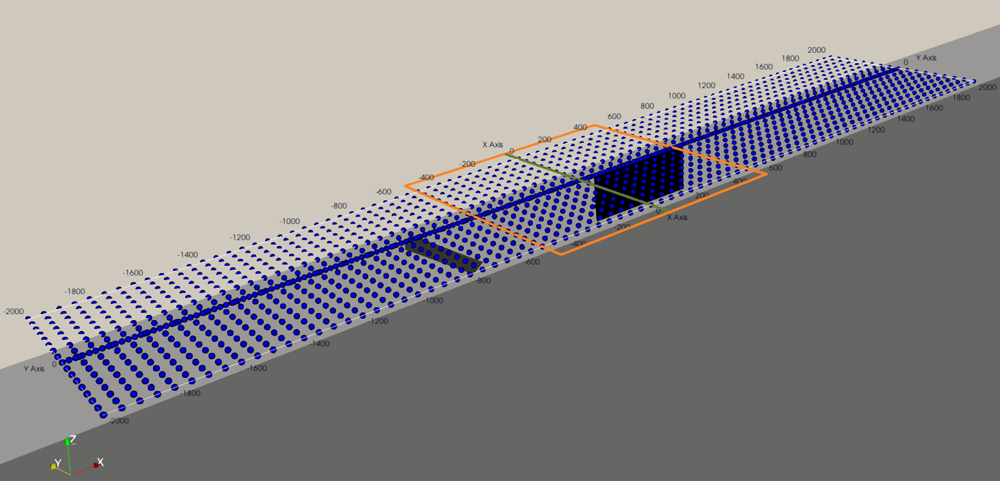

# Forward Model description

This forward model was designed to simulat a land-based, ground-based
transmitter (except AMT) and receiver setup to simulate either frequency-domain
or time-domain electromagentic field data, or impedances and tipper data
without a controlled-source

This model may serve as basis to be later on up- or downscaled to mimic
shallower or deeper exploration scales, or include topography topography,
airborne receivers, or other features...

*3D view of central model area, anomalies (plate: blue, cylinder: red) and
transmitters (dipole: green, loop: orange).*

*3D view of complete model, layers and anomalies (greyish colors),
transmitters (dipole: green, loop: orange), and receivers (blue dots).*

- **2 layer model**:
    - 1st layer thickness:
        300m
    - resistivities:
        500Ohmm, 5000Ohmm
- **2 possible Tx**:
    - grounded Tx:
        1km from y=-500 to y=500m, x=0, z=0
    - loop Tx:
        1km * 1km - x/y from (-500, -500) to (500, 500) m
- **2 possible rx patches**:
    - central Rx profile:
        4km from x=-2000 to x=2000, y=0, z=0
    - receiver grid:
        4km * 800m with 50m point spacing,
        x/y from (-2000., -400) to (2000, 400) m

- **anomaly geometry**
    - eastern anomaly: thin plate, tilted
        - incl:
            45°
        - decl:
            45°
        - thickness:
            50m
        - size:
            300m (length) * 500m (width)
        - center position:
            (500, 0, -150)
        - resistivity:
            10 Ohmm

    - western anomaly: cylinder
        - size:
            100m radius * 500m length
        - center:
            (400, 100, -150)
        - resistivity:
            5000 Ohmm
        - dip:
            90° (horizontal orientation along x axis)
        - dip_azimuth:
            0°

- **CSEM setup**
    - frequencies:
        [1, 10, 100, 1000, 10000] (Hz)

- **AMT setup**
    - frequencies:
        [1, 10, 100, 1000, 10000] (Hz)
    - no CSEM TX but MT-like sources (Two polarizations as boundary-condition)

- **TEM setup**
    - times:
        [0.0001 - 1] (s), 41 log-steps with 10 per decade between 0.1ms and 1s

## custemx model setup

### Mesh generation
    - **mesh generation script numbers**: *custemx/01...py*
    - central model with layered-earth geometry: 10 * 10 * 10 km
    - outer (halfspace) dimensions: 100 * 100 * 100 km
    - output mesh: vtk files in *meshes/tmp*, can be
      visualized with Paraview by opening the mesh *NAME.1.vtk*
    - Rx and Tx can be visualized with Paraview after mesh generation by
      importing *NAME_rx.vtk* and *NAME_tx.vtk* files
    - input for FE modeling: converted xdm5/h5 with meshtags in *meshes*

### FE simulation
    - ""simulation script numbers**: *custemx/11...py*

### Visualization
    - "plot script numbers": *custemx/21...py*

